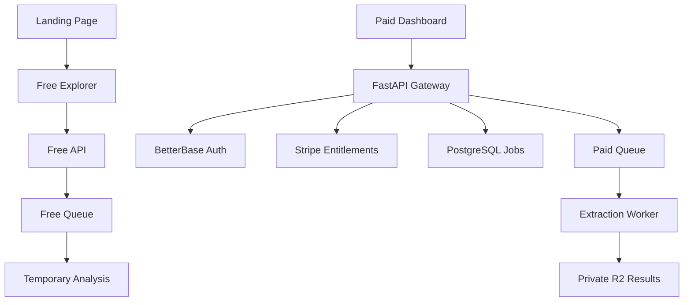
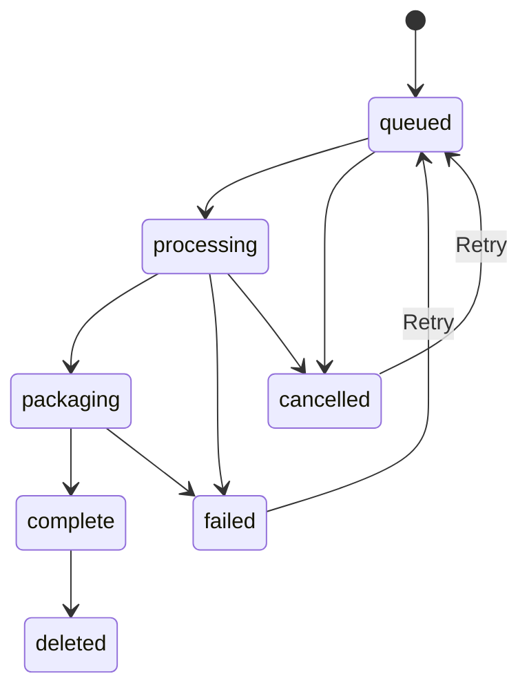

# ⚡ Universal Executable Decompiler (Exe-Decompiler)

> **Universal Windows & Electron Executable Reverse Engineering Platform**  
> *A high-performance binary inspection tool, PE resource extractor, PyInstaller unpacker, and Electron ASAR archive decompilation suite.*

---

## 🌐 Official Web Portal & Downloads

Visit our live web platform: **[https://decompiler.kaywat.codes/](https://decompiler.kaywat.codes/)**

### 📥 Download Options:

1. ⚡ **Official Windows Setup Installer (`Exe-Decompiler-Setup.exe`)**:
   - Download directly via the **[Cloudflare CDN Installer Stream](https://exe-decompiler-downloader.gvtechhub.workers.dev/download)** or from **[GitHub Releases](https://github.com/itsKayWat/Exe-Decompiler_dev/releases)**.

2. 🚀 **Direct Standalone Executable (`Exe-Decompiler.exe`)**:
   - Download the portable executable directly without installer setup:
   - **[Direct Download (.exe) via Google Drive](https://drive.google.com/uc?export=download&id=1gXamvoHcV9vG0WPeiDS5ol89PKijLG5m)**

---

## 🔥 Project Status & Recent Milestones (v1.2.0 - Production Ready)

The Exe-Decompiler platform is **fully production ready** and actively servicing reverse engineers, security analysts, and malware researchers.

- 💳 **Stripe Billing & Subscription Parity (`v1.2.0`)**: Fully integrated Stripe checkout supporting **$20.00/mo Monthly** and **$16.00/mo Annual** ($192/year) pricing tiers. Features instant session verification, automatic promotion code processing, and seamless checkout redirects.
- ⏱️ **Job Lifecycle & Expiring Soon Scheduling**: Hardened job retention engine featuring an *Expiring Soon* timeline widget (showing jobs approaching retention windows) and non-destructive historical database indexing for perpetual lookups.
- 🎛️ **Persistent Workspace Operations Sidepanel**: Standardized single-page app layout with persistent sidepanel metrics, quick actions, and calendar status widgets across all workspace views (`jobs`, `subscription`, `settings`, `results`).
- 📡 **Real-Time Event Streaming & Instant Entitlements**: Low-latency WebSocket job progress streaming via Redis pub/sub with sequence deduplication, automatic reconnect backoff, polling fallback, and instant polling session verification post-checkout.
- 🔒 **Private Paid Results Workspace (`results.html`)**: Manifest-driven, user-scoped results viewer featuring section tabs for PE Headers, PE Sections, Import Dependencies, String Inventory, PE Resources, Electron ASAR source trees, PyInstaller bytecode, Source Map restoration, Paginated Extracted Files Browser with code preview, line numbers, and download packages.
- 🔬 **Public Free Decompiler Explorer (`explorer.html`)**: Side-by-side code inspection viewports for PE Headers, Disassembly, ASAR, PyInstaller, Strings, and Imports with 1:1 synchronized line-number gutters, per-column copy controls, and deep-linkable URL sessions (`?analysisId=...`).
- 🛡️ **Cryptographic Free-Tier Rate Limiting**: Keyed HMAC-SHA256 visitor fingerprinting with dedicated `RATE_LIMIT_SECRET` protecting free engine queues.
- 🧱 **Hardened Production SaaS Infrastructure**: Production backend architecture utilizing FastAPI web services, PostgreSQL database persistence, Redis job queues, isolated background workers, and private R2 object storage.

---

## 🌟 Core Capabilities & Extraction Engines

- 🔍 **Automated Binary Classification**: Instantly identifies target binary frameworks—including **Electron (ASAR)**, **PyInstaller**, **.NET Assemblies**, and **Native Windows PE**.
- 📦 **ASAR Archive Unpacker**: Extracts internal JavaScript source bundles, configuration files, and assets from Electron application `.asar` packages.
- 🐍 **PyInstaller De-Archiver**: Extracts compiled Python bytecode (`.pyc`) and embedded DLL dependencies from PyInstaller executables.
- 🛠️ **PE Header & Resource Dumper**: Extracts embedded icons, string tables, bitmaps, manifests, and section structures directly from PE headers.
- 🗺️ **Source Map Inspector**: Discovers and decodes embedded JavaScript/TypeScript source maps to reconstruct original un-minified source code.
- 🛡️ **Hardened C++ Engine & Desktop GUI**: Features a custom dark-themed Windows desktop application with dependency verification, interactive file trees, and built-in GitHub issue tracking.

---

## 🏗️ Architecture Overview

### 🔄 Job Lifecycle & State Machine

---

## 🗺️ Development Roadmap

- [x] **v1.1.1-beta**: Paid Workspace Shell & Authentication Paywall Gating.
- [x] **v1.1.2-beta**: Persistent Job Infrastructure, PostgreSQL schema, Redis RQ queue & private storage abstraction.
- [x] **v1.1.3-beta**: Production Hardening, Stripe webhook idempotency, CORS, and health checks.
- [x] **v1.1.4-beta**: Public Free Explorer (`explorer.html`), side-by-side inspection viewports, and free vs. paid results separation.
- [x] **v1.1.5-beta**: Paid Results Explorer (`results.html`) with interactive source-map viewer and paginated file browser.
- [x] **v1.1.6-beta**: Real-time jobs, WebSocket status streaming, automatic reconnect backoff, polling fallback, cancel/retry endpoints, and stalled worker recovery.
- [x] **v1.1.7-beta**: Job Lifecycle Hardening, Expiring Soon scheduling, permanent historical database index, and quota management.
- [x] **v1.2.0**: **Production Release** — Catalog Parity ($20/mo & $16/mo Annual), instant session verification, persistent ops sidepanel layout, and platform hardening.
- [ ] **v1.3.0**: Developer API Keys Hub & Webhook Event Automation (Coming Soon).
- [ ] **v1.4.0**: Ghidra Cloud Worker integration (headless container, CPU/memory caps, decompiled C-like browser).
- [ ] **v1.5.0**: AI Reverse Engineering Assistant (LLM-powered threat summaries, variable renaming, function explanation).

---

## ⚖️ Legal & Privacy Disclaimer

*This software and platform are provided for educational, security auditing, and interoperability research purposes. Users are responsible for ensuring compliance with applicable copyright laws, license agreements, and software terms of service.*

---

## 🏢 Maintenance & Security Policy

All roadmap planning, internal task tracking, and proprietary backend source code are maintained in private development repositories. Only sanitized ecosystem documentation, security notices, installer binaries, and public interface specifications are published to this public release repository.

---

© 2026 **[Exe-Decompiler](https://decompiler.kaywat.codes/)**. A **[KayWat Codes](https://kaywat.codes/)** Production. All rights reserved.
